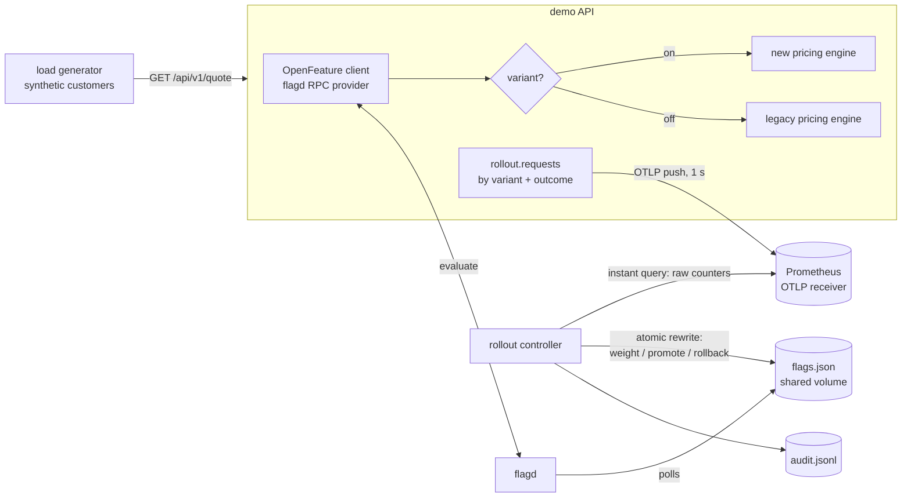
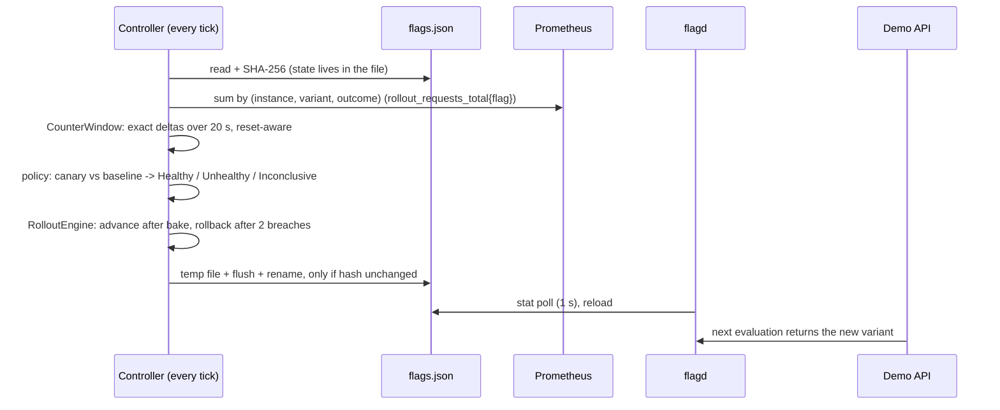

# flags-rollout

[](https://github.com/hekimcan206/flags-rollout/actions/workflows/ci.yml)
[](https://github.com/hekimcan206/flags-rollout/actions/workflows/codeql.yml)


[](LICENSE)

Canary releases with OpenFeature and flagd, and a small controller that rolls the flag back on its own when the new
code path starts failing. The service evaluates the flag per customer, counts requests by the variant it actually
served, and pushes the counts to Prometheus. The controller reads them, judges the canary against the baseline, walks
the canary up (10% -> 25% -> 50% -> 100%) while it stays healthy, and turns it off for everyone when it does not.

It is a lab project: the controller is the vehicle, the question is **which rule decides "unhealthy"**. Four policies
run through the same simulated traffic, and the literal reading of "roll back when the error rate crosses a threshold"
turns out to roll back every healthy canary during an unrelated outage.

> All data is synthetic: customers are generated ids (`c-00042`), prices are derived from a hash of the id. There is
> no real personal, payment or business data.

## Results

| Measured | Result |
|---|---|
| Compose demo: canary at 25% starts failing 30% of requests -> controller rolls the flag back | **4.0 s** median (5 runs: 4.0-6.0 s, two or three 2-second ticks) |
| Customers who saw an error from the broken canary before the rollback | **29** median, out of 92 canary requests after the fault, at 100 req/s total |
| flagd picks up a rewritten flag file | **597 ms** median, 996 ms max (40 writes; flagd polls the file every second) |
| Shared incident (both variants fail 12% for 2 min): healthy canaries rolled back | fixed 5% threshold **100%**, combined policy **0.3%** (300 runs each) |
| Healthy canary (1% vs 1%): false rollbacks | naive threshold 4.3%, relative test alone 4.7%, combined **0%** |
| Canary failing 50%: detection, errors served | combined 10 s and 138 errors vs naive 5 s and 75 (the cost of requiring two breaches) |
| Counts read back from Prometheus vs requests served | equal, request for request (integration test) |
| Raising the canary 10% -> 25% (2,000 customers, real flagd) | every customer on the canary at 10% stays on it at 25% |

Method, environment (shared, loaded host) and raw numbers: [docs/benchmarks.md](docs/benchmarks.md). Lab times are
simulated seconds; demo times are wall-clock.

## How it works





The pieces:

- **`FlagsRollout.Core`**: pure, no I/O. `CounterWindow` (exact per-variant counts from cumulative counters),
  `ThresholdPolicy` / `RelativePolicy` / `CombinedPolicy`, the `RolloutEngine` state machine and `FlagDocument`, which
  rewrites one flag in a flagd file without touching anything else.
- **`FlagsRollout.Controller`**: the loop. Reads Prometheus, reads and writes the flag file, serves `GET /status`,
  writes an audit log, exports its own metrics.
- **`FlagsRollout.DemoApi`**: a checkout quote endpoint with an old and a new pricing engine behind the flag
  `new-pricing-engine`, plus a fault-injection endpoint for the demo.
- **`FlagsRollout.LoadGen`**: plays the operator and the customers, breaks the canary mid-rollout and reports.
- **`FlagsRollout.Lab`**: the policy simulation and the propagation measurement.

## Why this design

Each decision has an ADR with the options that lost.

- **The flag file is the actuation channel** ([ADR 0001](docs/adr/0001-flag-file-as-the-actuation-channel.md)). flagd
  has no write API, so the controller changes what flagd reads: an atomic rename, guarded by the hash of the content it
  read, so a human edit is never silently reverted. The rollout state lives in the flag's `metadata`, which flagd returns
  with every evaluation, so a restarted controller resumes from the file.
- **Count by served variant, compute exact deltas** ([ADR 0002](docs/adr/0002-per-variant-counters-via-otlp-into-prometheus.md)).
  The service labels every request with the variant the evaluation returned (OpenTelemetry feature-flag semantic
  conventions), pushes OTLP straight into Prometheus 3's native receiver, and the controller computes integer deltas
  itself instead of PromQL's extrapolated `increase()`, because the policies run significance tests on small counts.
- **Unhealthy = over the budget AND worse than the baseline** ([ADR 0003](docs/adr/0003-combined-threshold-and-relative-health-policy.md)).
  The threshold says whether it is bad enough to act on; a two-proportion z-test says whether it is the canary's fault.
  The lab table is the argument.
- **Fail static, terminal rollback** ([ADR 0004](docs/adr/0004-failure-modes-fail-static-and-terminal-rollback.md)).
  No metrics means no change in either direction. Too little traffic means no promotion. A rolled-back flag stays off
  until a human restarts it; the controller never turns a flag on by itself.
- **Sticky, monotonic buckets** ([ADR 0005](docs/adr/0005-sticky-monotonic-bucketing.md)). Hash flag key plus customer
  id, canary bucket first: raising the weight only adds customers, so nobody flips between two prices.
- **Test against the real thing** ([ADR 0006](docs/adr/0006-testing-real-flagd-and-prometheus-plus-a-simulation-lab.md)).
  Real flagd and Prometheus in Testcontainers; the lab runs production analysis code on simulated traffic.

## Quick start

Requirements: Docker. For the tests and the lab, .NET SDK 10.0.400 or later.

```bash
docker compose up --build
```

The load generator starts the canary at 10%, the controller advances it to 25% after 10 healthy seconds, the load
generator breaks the new pricing engine, and the controller rolls back:

```text
[   0.7s] canary started: /flags/flags.json reset from /seed/flags.json
[   0.7s] controller: 10% (collecting the first window)
[  12.3s] controller: 25% (healthy for 10s at 10%: canary 0.00% (0/102) vs baseline 0.29% (3/1041), z=-0.54)
[  12.3s] fault injected: new pricing engine now fails 30% of requests
[  16.3s] controller rolled back: 2 unhealthy checks in a row at 25%: canary 11.83% (22/186) vs baseline 0.29% (4/1357), z=11.46
{"scenario":"canary-fault-rollback","rps":100,"canaryErrorRate":0.3,"stepsObserved":[10,25],"faultAtPercent":25,"rolledBack":true,"faultToDecisionMs":4005,"faultToLastCanaryResponseMs":4034,"canaryRequestsAfterFault":90,"canaryErrorsAfterFault":24,"baselineErrorsAfterFault":2,"canaryResponsesAfterQuiet":0,"requestsTotal":2182,...}
```

While the stack runs (ports bound to 127.0.0.1):

| | |
|---|---|
| `curl localhost:58381/status` | controller phase, percent, last verdict with both variants' counts |
| `curl "localhost:58380/api/v1/quote?customerId=c-00042&items=3"` | a quote, with the engine and variant that served it |
| `localhost:58380/scalar` | API reference |
| `localhost:58390` | Prometheus; try `sum by (feature_flag_result_variant, outcome) (rollout_requests_total)` |
| `docker compose run --rm loadgen` | run the scenario again (it resets the flag to 10% first) |

The rollback reason is written into the flag's `metadata` (flagd returns it with every evaluation), the controller's
`/status` and log, and the audit log on the shared volume: `docker compose cp controller:/flags/audit.jsonl .`.
`docker compose down -v` removes everything.

Tests and the lab:

```bash
dotnet test                                                              # unit, property, golden + Testcontainers
dotnet run -c Release --project benchmarks/FlagsRollout.Lab -- policies 300
dotnet run -c Release --project benchmarks/FlagsRollout.Lab -- propagation 40
```

## Configuration

Controller settings (`Rollout` section, environment variables like `Rollout__BakeTime`):

| Setting | Default | Demo | Meaning |
|---|---|---|---|
| `Steps` | `[10, 25, 50]` | same | canary percentages; promotion to 100% follows the last |
| `BakeTime` | 2 min | 10 s | healthy time required at each step |
| `TickInterval` / `Window` | 5 s / 60 s | 2 s / 20 s | how often to judge, over how much history |
| `Policy` | `Combined` | same | `Threshold`, `Relative` or `Combined` |
| `MaxErrorRate` | 0.05 | same | the error budget for the canary |
| `MinRequests` | 100 | 50 | per variant and window, below which the verdict is inconclusive |
| `ZCritical` / `MinAbsoluteIncrease` | 3.09 / 0.01 | same | relative test: significance and effect-size floor |
| `BreachesToRollback` | 2 | same | consecutive unhealthy verdicts before rollback |

## Tests

99 tests: 92 in `FlagsRollout.UnitTests` (75 unit, 5 FsCheck properties, 5 golden flag-file rewrites, 7 control-loop
tests on a real file with a fake clock) and 7 in `FlagsRollout.IntegrationTests` against flagd v0.18.2 and Prometheus
v3.15.1 in Testcontainers, including the full loop: demo API under load, real controller, broken canary, rollback,
traffic back on the baseline.

## Limitations and next steps

- **One flag, one controller, one file.** No leader election: two controllers on the same file would fight (the hash
  check makes them lose writes, not corrupt the file). Next: a lease, or the Kubernetes `FeatureFlag` resource with
  optimistic concurrency from the API server.
- **A narrow race with human edits.** The hash check and the rename are not one atomic step; a human save that lands in
  between is overwritten without notice (ADR 0001).
- **Error rate only.** Latency regressions and business metrics (conversion, basket value) are not judged. Kayenta-style
  multi-metric scoring is the natural extension.
- **Repeated testing is not corrected.** The relative test alone falsely rolled back 4.7% of healthy canaries in the
  lab; the combined policy masks this with the budget. A sequential probability ratio test would bound it properly.
- **Low traffic stalls.** Below about 100 canary requests per window the rollout waits forever by design; there is no
  alerting on a stalled rollout beyond `/status`.
- **Propagation is flagd's poll.** About half a second median, up to a second. In-process evaluation or the gRPC sync
  stream would be faster; not measured here.
- **Demo-grade security.** Prometheus' OTLP receiver and the services are unauthenticated on the compose network; the
  fault-injection key is a development value. See [docs/threat-model.md](docs/threat-model.md).
- **Not measured on Kubernetes.** ConfigMap volumes update on the kubelet's sync period (about a minute), which would
  dominate rollback time; a port should patch the flag through the API.

## Privacy note

The demo processes no personal data. Customer ids are generated, metrics carry only flag key, variant and outcome, and
logs carry no request bodies. A real deployment that buckets by customer id should treat that id as personal data under
KVKK (Turkey's personal data protection law) and GDPR in logs and traces, and must keep it out of metric labels.

## License

[MIT](LICENSE)
